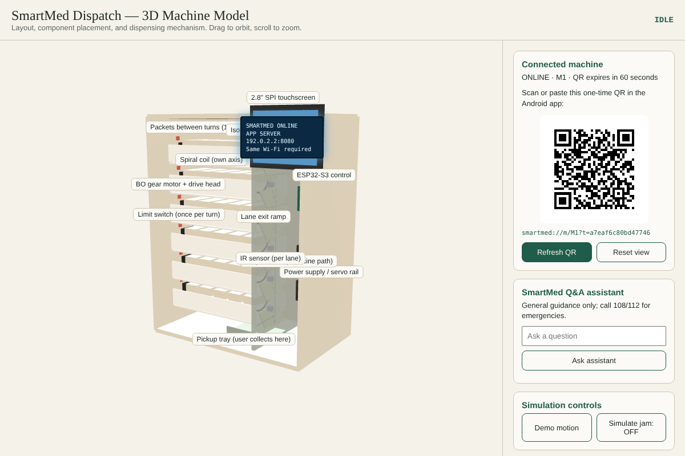
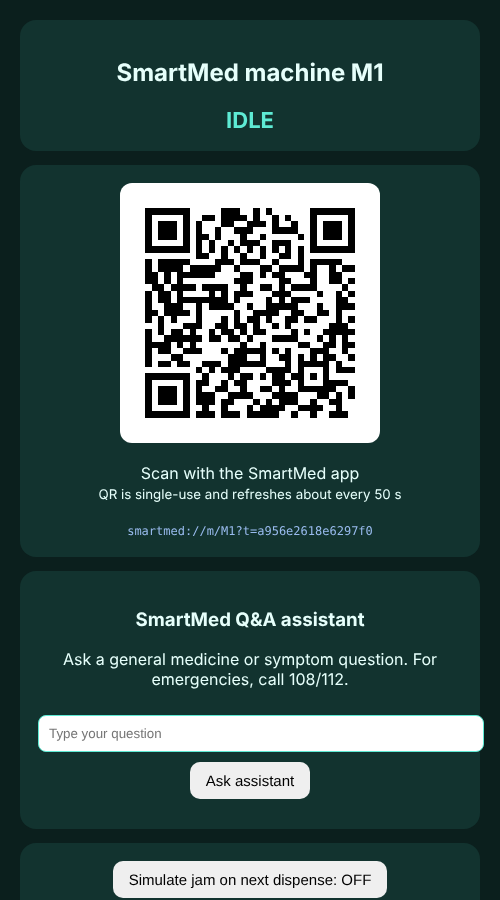
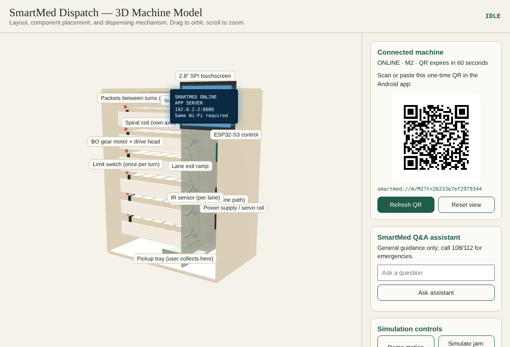
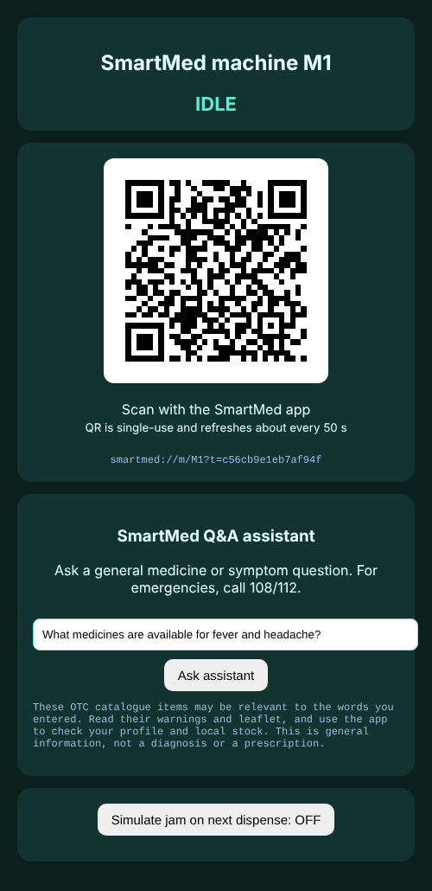

<div align="center">


# SmartMed — Autonomous Medicine Dispensing & Telemedicine Ecosystem

**Internet-connected smart kiosk network · Offline-first prototype · Multi-role Android app**

---


</div>

---

SmartMed bridges the **last-mile medicine access gap** — pairing an IoT-enabled physical dispensing kiosk with a cloud-connected telemedicine platform. It delivers 24/7, clinically supervised access to essential OTC medicines, physician-prescribed drugs, and time-critical emergency treatments via 4G/5G cellular IoT and cloud microservices.

---

## 🖥️ Live Screenshots

> *All screenshots taken from the **running prototype** — no mockups.*

### 3D Machine Simulation — Component-labelled Kiosk Model



> The interactive Three.js simulation shows the spiral-lane dispenser with labelled components: **ESP32-S3 controller**, **BO gear motor + drive head**, **IR sensor per lane**, **limit switch**, **lane exit ramp**, and **pickup tray**. The right panel shows the live QR code and Q&A assistant.

---

### 2D Machine Interface — M1

<div align="center">



</div>

> The 2D machine view shows the kiosk in **IDLE** state with a live, single-use **machine-identity QR** (`smartmed://m/M1?t=…`) that refreshes every 50 seconds. This is what the physical ESP32 screen would display.

---

### 3D Simulation — M2



> Machine M2 is **ONLINE** with its own independent QR session. Each machine maintains separate heartbeats, QR sessions, command queues, and lane inventories.

---

### Q&A Assistant — Medicine Guidance

<div align="center">



</div>

> Built-in AI-assisted Q&A on the machine panel — answers general medicine questions from the OTC catalogue. For emergencies, it prominently directs users to dial **108 / 112**.

---

## 🏗️ Architecture: Main Product vs. Prototype

| | 🌐 Main Commercial Product | 🧪 This Repository (Prototype) |
|:--|:--|:--|
| **Connectivity** | 4G/5G cellular IoT + MQTT over TLS | Local Wi-Fi / phone hotspot |
| **Backend** | AWS/GCP cloud microservices | Node.js 22.13+ on `localhost:8080` |
| **Database** | Distributed PostgreSQL/Supabase + HIPAA | Built-in SQLite (WAL mode, trigger-enforced audit) |
| **Payments** | Live UPI/card gateways (Razorpay/PayTM) | Order-bound QR simulation (no real payments) |
| **Hardware** | Industrial ESP32-S3 kiosks | Browser-based 2D + Three.js 3D simulator |
| **Identity** | Aadhaar/ABHA + SMS OTP | Dev OTP `123456` |
| **IoT Protocol** | MQTT over TLS + push commands | REST HTTP polling + 15 s heartbeats |

> This codebase validates the exact mechanical state machine, multi-tier clinical safety rules, two-phase QR authentication, and jam recovery workflows — **zero external cloud, Docker, SMS, or runtime npm packages required.**

---

## ⚠️ Safety & Scope Notice

> [!WARNING]
> SmartMed is a **demonstration prototype and testing testbed only** — not a certified medical device, pharmacy system, emergency service, or payment product. It must **not** be used to diagnose, prescribe, dispense, or administer real medicines. Use sealed empty boxes or placebos during demonstrations only.
>
> The seeded medicine catalogue, dosage text, age limits, and emergency formulary are **illustrative**. Any commercial deployment requires clinical governance, licensed pharmacy participation, regulatory approval, validated hardware, and local legal compliance.

---

## 📋 Contents

- [🎯 Project Goals](#-project-goals)
- [💊 Medicine Catalogue](#-medicine-catalogue)
- [🤖 Machine Inventory](#-machine-inventory)
- [📦 What is Included](#-what-is-included)
- [🏛️ System Architecture](#%EF%B8%8F-system-architecture)
- [🔄 End-to-End Workflows](#-end-to-end-workflows)
- [🛡️ Safety, Controls & Data Handling](#%EF%B8%8F-safety-controls-and-data-handling)
- [🌍 Applications & Social Impact](#-applications-and-social-impact)
- [🧰 Technology Stack](#-technology-stack)
- [🚀 Getting Started](#-getting-started)
- [👤 Local Accounts & Scenarios](#-local-accounts-and-scenarios)
- [🔌 Machine Integration Contract](#-machine-integration-contract)
- [🧪 Testing & Operational Checks](#-testing-and-operational-checks)
- [📁 Repository Guide](#-repository-guide)
- [🗺️ Limitations & Roadmap](#%EF%B8%8F-current-limitations-and-roadmap)

---

## 🎯 Project Goals

```
┌─────────────────────────────────────────────────────────────────────┐
│  1. 🏥  Seamless Healthcare Access                                   │
│         24/7 medicines + remote consultations in rural areas,        │
│         transit hubs, campuses                                       │
├─────────────────────────────────────────────────────────────────────┤
│  2. 🔐  Appropriate Multi-Tier Access                                │
│         OTC → Prescription → Emergency: strict regulatory isolation  │
├─────────────────────────────────────────────────────────────────────┤
│  3. 👨‍⚕️  Human Clinical Oversight                                     │
│         Verified doctor role + 60-second backup escalation           │
├─────────────────────────────────────────────────────────────────────┤
│  4. 📋  Traceable Dispensing & Physical Safety                       │
│         Append-only audit trail from order → dispense                │
├─────────────────────────────────────────────────────────────────────┤
│  5. ⚡  Operational & Edge Resilience                                │
│         Safety rules + jam recovery work offline on edge devices     │
└─────────────────────────────────────────────────────────────────────┘
```

---

## 💊 Medicine Catalogue

> Real seeded data from `medivend.db` — 19 medicines across 3 access tiers.

### 🟢 Tier 1 — Over the Counter (OTC)
*Available directly to any verified patient — no prescription needed.*

| Medicine | Generic | Category | Min Age | Max/Order |
|:--|:--|:--|:--:|:--:|
| Paracetamol 500 mg strip | Paracetamol | Fever / Pain | 18 | 2 |
| ORS sachet | ORS | Hydration | 0 | 4 |
| Cetirizine 10 mg strip | Cetirizine | Allergy | 18 | 2 |
| Throat lozenges | — | Cold / Throat | 12 | 2 |
| Antacid gel sachet | — | Digestive | 12 | 2 |
| Povidone-iodine solution | — | Antiseptic | 0 | 2 |

### 🟡 Tier 2 — Prescription Only (Rx)
*Requires a valid, unused e-prescription issued by a verified doctor.*

| Medicine | Generic | Category | Min Age |
|:--|:--|:--|:--:|
| Amoxicillin 500 mg | Amoxicillin | Antibiotic | 18 |
| Azithromycin 500 mg | Azithromycin | Antibiotic | 18 |
| Amlodipine 5 mg | Amlodipine | Blood Pressure | 18 |
| Metformin 500 mg | Metformin | Diabetes | 18 |
| Pantoprazole 40 mg | Pantoprazole | Digestive | 18 |

### 🔴 Tier 3 — Emergency Only
*Requires live doctor approval OR a pre-authorised emergency pass.*

| Medicine | Notes |
|:--|:--|
| Adrenaline auto-injector (emergency pack) | Anaphylaxis |
| Salbutamol inhaler (emergency pack) | Acute asthma |
| Aspirin 325 mg chewable (emergency pack) | Cardiac emergency (age ≥18) |
| Isosorbide dinitrate 5 mg sublingual (emergency pack) | Cardiac emergency (age ≥18) |
| Oral glucose powder (emergency pack) | Hypoglycaemia |
| Antihistamine tablet (emergency pack) | Severe allergy (age ≥18) |
| ORS emergency pack | Severe dehydration |
| Paracetamol emergency pack | Emergency fever/pain (age ≥18) |

> ⚠️ Tier 3 orders cannot be combined with Tier 1 or Tier 2 items. Tiers are strictly isolated per order.

---

## 🤖 Machine Inventory

> 3 demo machines — each with 6 lanes stocked with Tier 1 and Tier 3 medicines.

| Machine | Lanes |
|:--|:--|
| **M1** | Paracetamol · ORS · Cetirizine · Adrenaline · Salbutamol · Aspirin |
| **M2** | Paracetamol · Antacid · Povidone-iodine · Amoxicillin · Glucose · Isosorbide |
| **M3** | Paracetamol · ORS · Throat lozenges · Antihistamine · Salbutamol · Cetirizine |

> Inventory uses **FEFO** (First Expiry, First Out). All lanes seeded with batch `B-N-DEMO`, expiry `2028-06-30`.

---

## 📦 What is Included

### 📱 Patient Android App
- Register with any 10-digit mobile number; OTP verification; role selection
- Profile: date of birth · allergies · conditions · current medicines
- **3 access paths:** offline Q&A guidance · direct medicine search · machine-display-assisted order
- Order-bound payment QR + separate machine-identity QR for collection
- Emergency request creation + live status tracking
- Emergency-pass application with supporting document upload
- Use of an approved pass when declared red-flag symptoms match

### 🩺 Doctor Android App
- Availability control + emergency-case queue
- Case acceptance · patient-context review · approval / rejection of emergency packs
- E-prescription issuance for Tier 2 medicines
- Review · issuance · rejection · revocation of patient emergency passes
- Backup-panel escalation after 60-second unanswered emergency request

### 🔧 Worker Android App
- Machine and lane visibility
- Lane refills: medicine · quantity · batch · expiry date
- New-machine registration with 6 initial lanes + generated machine API key

### 🖥️ Local Backend & Machine Views
- Node.js HTTP API + file-backed SQLite database
- Built-in **2D dispenser interface** + connected **Three.js 3D cabinet simulation**
- Machine heartbeats · short-lived QR sessions · command polling · dispense-result reporting · simulated jams
- Automatic stock restoration + refund creation + support-ticket creation on failure

---

## 🏛️ System Architecture

### 1. 🌐 Main Product Architecture (Cloud-Connected)

```
 ┌────────────────────────────────────────────────────────────────────────────┐
 │                         SMARTMED CLOUD PLATFORM                            │
 │  Scalable Microservices (REST / WebSockets) · Distributed Cloud DB         │
 │  Real-Time Clinical Rules Engine · Telemedicine Gateway                    │
 │  UPI / Card Payment Webhooks · Central Fleet & Inventory Management        │
 │  Trigger-Protected Append-Only Audit Trail                                 │
 └──────────────────────▲────────────────────────────▲───────────────────────┘
                        │ HTTPS / WSS                │ MQTT over TLS / Cellular
                        │                            │
 ┌──────────────────────▼──────────────┐  ┌──────────▼─────────────────────────┐
 │ MULTI-ROLE MOBILE APP SUITE         │  │ SMARTMED IOT DISPENSING KIOSK       │
 │                                     │  │                                     │
 │ 👤 Patient: AI triage, calls, pay   │  │ ⚙️  Industrial ESP32-S3 Controller  │
 │ 🩺 Doctor: Queue, Rx & Pass issue   │  │ 📡  4G/5G Cellular + Wi-Fi         │
 │ 🔧 Worker: Replenishment & diag.    │  │ 🖥️  Touch SPI TFT + Camera         │
 └─────────────────────────────────────┘  │ 🌀  6+ Spiral Lanes + BO Motors    │
                                          │ 🔦  Dual IR Break-Beam Sensors      │
                                          │ 🌡️  Thermal + Tamper Monitoring     │
                                          └─────────────────────────────────────┘
```

### 2. 🧪 Local Prototype Architecture (This Repository)

```
                     private Wi-Fi / phone hotspot

 ┌─────────────────┐       REST API        ┌────────────────────────────┐
 │  Android App    │ ◄───────────────────► │  SmartMed Local Server     │
 │                 │                        │  Node.js + built-in SQLite │
 │  👤 Patient     │                        │  rules engine + audit trail│
 │  🩺 Doctor      │                        └──────────────┬─────────────┘
 │  🔧 Worker      │                                       │
 └─────────────────┘                                      HTTP
                                                           │
                                            ┌──────────────▼─────────────┐
                                            │  Machine Interface          │
                                            │  2D simulator / 3D model /  │
                                            │  ESP32 test controller      │
                                            └────────────────────────────┘
```

> 🔑 **Server is the source of truth.** Eligibility and stock are checked again immediately before dispensing — not relying on any earlier client-side decision.

### 🗄️ Database Schema (20 Tables)

`users` · `auth_tokens` · `doctors` · `medicines` · `machines` · `lanes` · `qr_sessions` · `documents` · `emergency_requests` · `passes` · `pass_usage` · `prescriptions` · `orders` · `payments` · `dispense_events` · `commands` · `refunds` · `tickets` · `reminders` · `audit_logs`

> The `audit_logs` table is protected by **database triggers** that reject all updates and deletes — making it append-only.

---

## 🔄 End-to-End Workflows

### 🛒 1. Standard OTC Purchase

```
Patient profile
      │
      ▼
Browse Tier 1 medicine catalogue
      │
      ▼
Select an online machine
      │
      ▼
Create order  ◄── server checks: age · allergies · stock · expiry · limits
      │
      ▼
Scan order-bound payment QR (expires 5 min)
      │
      ▼
Scan machine-identity QR (single-use, 60 s)
      │
      ▼
Server issues lane command
      │
      ├──► ✅ Sensor confirms → Order complete
      └──► ❌ Fail / timeout → Stock restored + 💸 Refund + 🎫 Support ticket
```

### 💊 2. Prescription Medicine Purchase

```
🩺 Doctor issues Tier 2 e-prescription
         │
         ▼
👤 Patient selects covered medicine
         │
         ▼
Server verifies: prescription valid · unused · quantity · patient match
         │
         ▼
Payment QR → Machine collection QR → Dispense
         │
         ▼
Prescription marked USED (one-time only) ✅
```

### 🚨 3. Live Emergency Request

```
👤 Patient submits emergency request + describes situation
         │
         ▼
🩺 Doctor queue notified ──► (60 s timeout) ──► 🩺 Backup doctor panel
         │
         ▼
Doctor accepts + decides → approve / reject
         │
         ▼  (approval valid 1 hour · max 1 emergency order per patient per 24 h)
👤 Patient pays → Scans machine QR → Machine dispenses
         │
         ▼
📲 Follow-up reminder created · 📞 108/112 always offered if no doctor responds in 5 min
```

### 🪪 4. Pre-Authorised Emergency Pass

```
👤 Patient uploads supporting document
         │  applies for pass
         ▼
🩺 Doctor reviews → issues time-limited pass
         │  (up to 90 days · 1–2 uses · quantity limits · red-flag keys required)
         ▼
👤 Patient declares matching red flags → QR collection → usage logged
         │
         ▼
📲 Clinician + patient follow-up reminders created
         (Doctor can reject or revoke at any time)
```

### ⚡ 5. Dispense Failure & Recovery

```
Paid order → QR redeemed → Stock reserved → Command sent
      │
      ├──► success (≤60 s):   ✅ Order complete
      │
      └──► failure / no report:
                │
                ├── 🔄 Stock restored to lane (idempotent)
                ├── 💸 Payment marked refunded
                ├── 📄 Refund record created
                └── 🎫 Support ticket opened
```

### 📦 6. Inventory Operations (FEFO)

```
🔧 Worker signs in → Opens machine/lane
         │
         ▼
Records refill: quantity · batch number · expiry date
         │
         ▼
Server updates lane · Orders select earliest-expiring non-expired lane first
```

---

## 🛡️ Safety, Controls and Data Handling

| 🔒 Control | ⚙️ Prototype Behaviour |
|:--|:--|
| **Role separation** | Patient · doctor · worker: separate API paths and app screens |
| **Profile safeguards** | Age and recorded allergy checks enforced server-side before every order |
| **Medicine tiers** | Tier 1 = OTC · Tier 2 = Rx · Tier 3 = Emergency. Tiers cannot be mixed in one order |
| **Emergency controls** | Live approval or active pass · approval expiry · red-flag match · quantity limits · 24h cap — all server-side |
| **QR expiry** | Payment QR: **5 minutes** · Machine collection QR: **single-use, 60 seconds** |
| **Machine heartbeat** | Every **15 seconds** — machine treated offline after **2 minutes** without heartbeat |
| **Inventory** | Quantity reserved atomically before command; expired lanes excluded; failed dispenses restore stock |
| **Traceability** | Orders · payments · commands · dispense events · refunds · tickets · audit events persisted |
| **Document access** | Patient docs accessible only by their owner or a doctor with an active case/pass relationship |

### 🔓 Security Boundaries

> [!CAUTION]
> This prototype is **for controlled local networks only**. It uses HTTP cleartext, a fixed dev OTP (`123456`), locally persisted bearer tokens, and per-machine API keys in request headers. These are **not** production authentication, encryption, payment, or privacy controls.
>
> For production: TLS/mTLS · secure device identity & key rotation · audited OTP service · encrypted storage · least-privilege access · session expiry · secure ESP32 firmware · payment-provider callbacks · monitoring · backups · health-data governance.

---

## 🌍 Applications and Social Impact

| 🏷️ Setting | 💡 Use Case |
|:--|:--|
| 🚉 Transport hubs & highways | Access to basic supplies during travel, with pharmacy oversight |
| 🌾 Rural & low-connectivity areas | Local-first workflows with no continuous internet dependency |
| 🏥 Hospital peripheries | Supervised collection points for approved, prepacked items |
| ⛺ Disaster-relief clinics | Resilient local coordination in constrained-connectivity zones |
| 🎓 Healthcare training | Simulate patient–clinician–worker–dispenser interactions safely |

**Potential positive impact:** reduce travel burden for routine access · make stock and expiry visible · create a verifiable clinical-decision-to-dispense chain · preserve continuity on local networks · reduce delay for pre-assessed emergency needs.

> Technology must complement — not replace — clinicians, pharmacists, ambulance services, and public health infrastructure.

---

## 🧰 Technology Stack

| 🔧 Layer | 🌐 Main Commercial Product | 🧪 Prototype Testbed |
|:--|:--|:--|
| **📱 Mobile** | Kotlin + Jetpack Compose + Material 3 (SDK 24+) · video · push · UPI deep-link | Kotlin + Jetpack Compose + Material 3 · multi-role |
| **📷 QR** | ZXing Android Embedded — dynamic single-use tokens | ZXing + copy-paste fallback for emulator |
| **☁️ Backend** | Node.js/Go microservices on AWS/GCP · auto-scaling | Node.js 22.13+ native modules only · `localhost:8080` |
| **🗄️ DB** | PostgreSQL/Supabase · read-replicas · HIPAA/ABDM · backups | `node:sqlite` WAL mode · trigger-enforced append-only audit |
| **📡 IoT** | MQTT over TLS · 4G/5G cellular · push commands | REST `POST /api/machine` · 15 s heartbeats |
| **🤖 Hardware** | Industrial ESP32-S3 · dual IR break-beam sensors · load cells | Browser 2D (`/machine/M1`) + Three.js 3D (`/simulation/M1`) |
| **🔐 Identity** | Carrier SMS OTP · Aadhaar/ABHA · UPI (Razorpay/PayTM) | Dev OTP `123456` · order-bound QR payment simulation |
| **🖥️ Runtime** | Cloud platform + distributed field kiosks via cellular | Laptop server + Android devices on same Wi-Fi/hotspot |

---

## 🚀 Getting Started

### ✅ Prerequisites

| Requirement | Version / Notes |
|:--|:--|
|  | 22.13 or newer |
|  | Koala or newer · physical device or emulator |
| **Network** | Shared Wi-Fi or phone hotspot — internet not needed after first Gradle sync |

---

### Step 1 — 🖥️ Start the Local Server

```powershell
cd server
node --no-warnings server.mjs
```

> **Windows shortcut:** Double-click [`start-medivend.bat`](./start-medivend.bat) — starts the server when port `8080` is free and opens the M1 3D simulation.

On first start the server creates `server/data/medivend.db` and seeds users, machines, lanes, and medicines.

> 🔥 Allow Node.js through the Windows firewall on **Private** networks when prompted, so a phone on the same Wi-Fi can reach the laptop.

**Reset demo data:** stop the server → delete `server/data/medivend.db` and its `.db-shm` / `.db-wal` files.

---

### Step 2 — 🤖 Open a Machine Interface

Keep **one** interface open per machine. It supplies heartbeats, QR sessions, command polling, and dispense results.

| Interface | M1 | M2 | M3 |
|:--|:--|:--|:--|
| 🖥️ 2D screen | `/machine/M1?key=demo-key-1` | `/machine/M2?key=demo-key-2` | `/machine/M3?key=demo-key-3` |
| 🎮 3D simulation | `/simulation/M1?key=demo-key-1` | `/simulation/M2?key=demo-key-2` | `/simulation/M3?key=demo-key-3` |

> ⚠️ Do **not** open both 2D and 3D views for the same machine simultaneously — both poll the same command queue.

---

### Step 3 — 📱 Build & Run the Android App

1. Open the [`android`](./android) folder in Android Studio
2. Allow Gradle to sync *(internet required only for first dependency download)*
3. Run on emulator or Android device
4. Configure server address at login:

| Device | Server Address |
|:--|:--|
| 🖥️ Android Emulator | `10.0.2.2:8080` |
| 📱 Physical phone | `<LAN-IP>:8080` *(printed by server on startup — same local network required)* |

5. Enter any 10-digit number → OTP `123456` → choose your role

> 📸 **QR scanning on emulator:** copy the QR text shown beneath the browser display into the app — the emulator camera cannot scan from the same screen. Payment and collection QR values are always different.

---

## 👤 Local Accounts and Scenarios

Any 10-digit number registers with OTP `123456`. Seeded accounts for guided demos:

| 👤 Role | 📞 Phone | 🎯 Purpose |
|:--|:--|:--|
| 🙋 Patient | `9000000001` | Primary patient (Demo Patient · DOB 1998-04-21) |
| 🙋 Patient | `9000000002` | Second patient / multi-device demos |
| 🩺 Doctor | `9000000011` | Standard queue + prescriptions |
| 🩺 Backup Doctor | `9000000012` | Emergency escalation after 60 s |
| 🔧 Worker | `9000000021` | Refills + machine registration |

### 🎬 Suggested Walkthroughs

<details>
<summary>🛒 <strong>Walkthrough 1 — OTC Purchase (Paracetamol / ORS)</strong></summary>

Ask the Q&A assistant or search for ORS → add to basket → choose machine M1 → request payment QR → scan the separate machine collection QR → observe dispense completion.
</details>

<details>
<summary>💊 <strong>Walkthrough 2 — Prescription (Amoxicillin via M2)</strong></summary>

Sign in as doctor (`9000000011`) → issue an Amoxicillin prescription to patient `9000000001`. As that patient, select machine M2 → purchase → collect. Prescription is marked one-time-used after successful dispense.
</details>

<details>
<summary>🚨 <strong>Walkthrough 3 — Emergency Request + 60s Escalation</strong></summary>

Submit an emergency request from a patient account. On a doctor device, accept and approve. Return to patient to pay and collect. Use backup doctor (`9000000012`) after 60 s to demonstrate escalation.
</details>

<details>
<summary>🪪 <strong>Walkthrough 4 — Emergency Pass</strong></summary>

Upload a sample document → apply for emergency pass → issue it from the doctor account → use the pass from the patient account with a matching declared red flag.
</details>

<details>
<summary>⚡ <strong>Walkthrough 5 — Jam Recovery</strong></summary>

Activate **Simulate jam** on a machine view before collection. The server restores reserved stock and creates refund + support-ticket records after the failed result.
</details>

<details>
<summary>📦 <strong>Walkthrough 6 — Worker Operations</strong></summary>

Sign in as worker (`9000000021`) → update a lane with batch and expiry → register a new machine.
</details>

---

## 🔌 Machine Integration Contract

A real ESP32 controller uses the same endpoint as the browser simulation:

```
POST /api/machine
Header: x-machine-key: <machine API key>
Body:   { "machine_id": "M1", "action": "..." }
```

| ⚡ Action | 📋 Purpose | 🔁 Response |
|:--|:--|:--|
| `heartbeat` | Announce machine is reachable | `{ ok: true }` |
| `session` | Request a fresh collection QR | Returns QR text + expiry |
| `poll` | Read a pending dispense command | Returns `command` with `order_id` + lane/quantity, when available |
| `report` | Confirm physical dispense result | Send `order_id` + `result: "success"\|"fail"` + optional `reason` |

> A real controller must: poll or use a secured event channel · actuate only its own authenticated ID's command · validate sensors · report an unambiguous result · implement mechanical interlocks · secure firmware updates · offline-safe retry · and pass regulatory validation. The web simulator does not provide these properties.

---

## 🧪 Testing and Operational Checks

```powershell
# From the server/ directory:
node test/smoke.mjs
```

**All 21 checks pass:**

```
Auth and profile      ✅  login · OTP · roles enforced · catalogue isolation
OTC order             ✅  total · limits · idempotent payment · QR distinct · dispense
Jam & refund          ✅  failed dispense refunded + stock restored automatically
Timeout recovery      ✅  no sensor confirmation → auto-refund
Allergy rule          ✅  allergy blocks emergency request before doctor sees it
Rx flow               ✅  Tier 2 needs e-prescription · one-time use enforced
Emergency (live Dr)   ✅  queue · backup escalation · approve/pay/dispense/follow-up · 24h cap
Emergency Pass        ✅  red flags matched · no live doctor needed · usage counted + exhausted
Worker                ✅  lane refills · machine registration
Machine auth          ✅  machine key required

All 21 checks passed ✅
```

### ✅ Pre-Demonstration Checklist

- [ ] Server running and machine view is open
- [ ] App points at correct local server address
- [ ] Selected machine marked **online**
- [ ] Patient profile has **date of birth** (needed for age-restricted items)
- [ ] Only **one** browser machine view active per machine
- [ ] Demo uses **placebos or empty sealed packages** — no real medicines

---

## 📁 Repository Guide

```
SmartMed_V.3/
│
├── 📱 android/                          Android Studio project
│   └── app/src/main/java/com/medivend/app/
│       ├── PatientScreens.kt            Patient catalogue, basket, profile, guide
│       ├── DoctorScreens.kt             Clinical queue, passes, prescriptions
│       ├── WorkerScreens.kt             Refills and machine registration
│       ├── EmergencyScreens.kt          Emergency and collection workflows
│       ├── PassScreens.kt               Emergency pass application and use
│       ├── Ui.kt                        Shared UI components
│       ├── Api.kt                       Local API client + preferences
│       ├── LoginScreen.kt               Auth and role selection
│       └── MainActivity.kt              Entry point and navigation
│
├── 🖥️  server/
│   ├── server.mjs                       HTTP routes and domain operations
│   ├── rules.mjs                        Eligibility, safety, and stock rules
│   ├── lib.mjs                          SQLite schema, seed data, shared helpers
│   ├── qr.mjs                           QR generation utilities
│   ├── machine.html                     Connected 2D machine simulator
│   ├── 1_3D_Model/
│   │   └── SmartMed_3D_Model.html       Connected Three.js machine model
│   └── test/
│       └── smoke.mjs                    Backend smoke checks (21 tests)
│
├── 🪟  start-medivend.bat               Windows convenience launcher
└── 📄  README.md                        This file
```

> `server/data/` holds the SQLite database and uploaded demo documents — intentionally excluded from source control.

---

## 🗺️ Current Limitations and Roadmap

### ⚠️ Known Limitations

| Area | Limitation |
|:--|:--|
| 📱 Android | Compiled and tested. Keep Android SDK, JDK, and Gradle versions aligned when rebuilding on another machine. |
| 🔐 OTP & Payments | Local-dev implementations only — production requires real SMS OTP and payment-provider integrations. |
| 🛡️ Security | HTTP cleartext, fixed dev OTP, local tokens — not production-secure. |
| 🤖 Hardware | No ESP32 firmware, certified sensors, or production hardware control included. |
| 🖥️ Dashboard | No admin dashboard, multilingual UI, video consultation, notification delivery, or map/routing. |
| 🔔 Reminders | Reminder rows are recorded but no delivery service is included. |
| 💊 Catalogue | Medicine catalogue and clinical rules are demo data — not medical advice. |

### 🛣️ Recommended Next Steps

```
 Step 1  ──►  Validate Android build on target devices + automated mobile tests
    │
 Step 2  ──►  Co-design formulary, escalation rules, and UX with licensed
    │          clinicians, pharmacists, patients, and regulators
    │
 Step 3  ──►  Replace demo identity, payments, and cleartext HTTP
    │          with production-grade security and privacy controls
    │
 Step 4  ──►  Implement a secured ESP32 hardware controller with sensor
    │          reconciliation, interlocks, diagnostics, and remote maintenance
    │
 Step 5  ──►  Add role admin, inventory reconciliation, audit export,
    │          backups, observability, accessibility, multilingual content
    │
 Step 6  ──►  Threat modelling · clinical safety analysis · usability testing
              · hardware reliability testing · formal regulatory review
              — before any real-world trial
```

---

## 📜 License and Contribution

> No license file is currently included. Until a license is added by the project owner, treat the source as **all rights reserved** — request permission before reuse or redistribution.

**Contributing guidelines:**
- ✅ Keep all safety-critical rules **on the server**
- ✅ Add tests for changed workflow logic
- ❌ Do not commit `server/data/` files or secrets
- ✅ Document any change that affects clinical review, medication eligibility, stock accounting, or hardware behaviour

---

<div align="center">

**Built with ❤️ to bridge the last-mile medicine access gap**

*SmartMed Prototype v3 · Surat, India*

</div>
